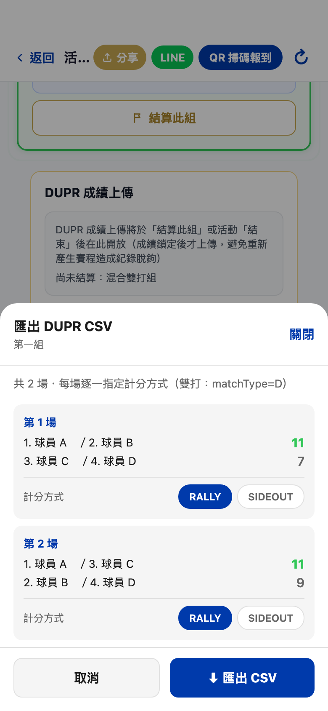

# 匯出 CSV

有些情況不能用一鍵上傳，例如組別裡有球員沒有連結 DUPR（組別旁標示「**用 CSV**」），或暫時無法上傳到 DUPR。這時可以把成績匯出成 CSV 檔，再自行匯入 DUPR。

CSV 是**每個賽程組一份**。

## 步驟

1. 到「**DUPR 成績上傳**」區，按「**匯出 CSV**」。
2. 如果這場活動有好幾個賽程組，會先列出每個賽程組的按鈕（例如「組別名稱 匯出 CSV」；同一個組別有多個賽程組時，會寫成「組別名稱（第 1 組） 匯出 CSV」）。按你要匯出的那一組。只有一個賽程組時，會直接進到下一步。

   <!-- 截圖：多個賽程組時的「○○ 匯出 CSV」按鈕列表 -->

3. 「**匯出 DUPR CSV**」視窗會列出這個賽程組的場次，每一場都有「**計分方式**」可以選 **RALLY** 或 **SIDEOUT**，一開始都是 RALLY。
   - 落地得分的場次選 RALLY，發球得分的場次選 SIDEOUT。
   - 如果這個組別打的是發球得分 11 分，請記得逐場改成 SIDEOUT。

   <!-- 截圖：匯出 DUPR CSV 視窗，每場的計分方式 RALLY／SIDEOUT -->
   

4. 如果有球員沒有填 DUPR ID，視窗上方會提醒「**有 N 位球員尚未填寫 DUPR ID**」，並列出名字。這些球員在檔案裡的 DUPR ID 欄位會是空白，匯入 DUPR 時需要手動補齊。
5. 按「**⬇ 匯出 CSV**」，檔案會下載或開啟分享。
6. 其他賽程組請重複第 1～5 步。

## 匯出前請核對場次

匯出視窗列出的是這個賽程組**所有已輸入比分的場次**，包括：

- 已經用一鍵上傳送到 DUPR 的場次；
- 你在上傳區選了「沒打完」而略過的場次，或被標記沒打完的場次。

匯出視窗不會標示哪些場次已經上傳過。為了避免同一場被送兩次，請在匯入 DUPR 前自行核對檔案，移除已經上傳過、以及你不打算送到 DUPR 的場次。

CSV 主要用在兩種情況：組別標示「用 CSV」，或[暫時無法上傳到 DUPR](rep-account-unavailable.md)。能一鍵上傳的場次，建議直接用上傳區的「上傳 N 場到 DUPR」。

## 相關說明

- [暫時無法上傳到 DUPR 時怎麼辦](rep-account-unavailable.md)
- [上傳區各狀態與數字的意義](../reference/score-format-and-upload-states.md#上傳區各狀態與數字的意義)
