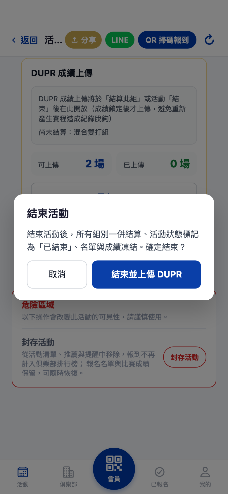

# 主辦（非團長）結束活動

如果你不是團長，但負責這場活動，也可以結束活動。結束之後會發生什麼，要看你**能不能上傳這場活動的 DUPR 成績**。

能上傳的人是：這個俱樂部的**團長（俱樂部管理員）**，以及這場活動中**同時是場主**的主辦。完整對照請看[誰能做什麼](../reference/roles-and-notifications.md#誰能做什麼)。

## 步驟

1. 確認所有場次的比分都已經輸入完成。活動結束後，只有團長能修改比分。
2. 到活動頁，按最下方的「**結束活動（整批結算所有組別）**」。
3. 看確認窗的內容，按確認。

<!-- 截圖：結束活動確認窗 -->

## 你是這場活動的主辦，也是場主

- 如果這場活動還有 DUPR 場次可以上傳，確認按鈕會是「**結束並上傳 DUPR**」。按下後，App 會帶你到「DUPR 成績上傳」區，你可以直接上傳。做法和團長一樣，請看[教學的第 5 步](../tutorials/dupr-first-upload.md#第-5-步在上傳區上傳成績)。

## 你是這場活動的主辦，但不是場主或團長

例如教練、一般會員，或已經離開俱樂部、卸任幹部的人，被列為這場活動的主辦。

- 你仍然可以結束活動，但不能上傳 DUPR 成績。確認按鈕會是「**確認結束**」。
- 確認窗會多一句「**結束後只有俱樂部管理員能修改比分**」。
  - 在 DUPR 活動裡，你可以看到各賽程組，但無法點進去修改比分。比分有誤時，請聯絡團長修改。
- 結束後，如果這場活動還有 DUPR 場次可以上傳，系統會自動通知團長，以及同時是場主的主辦，請他們上傳。
- 你在上傳區只會看到「誰能上傳」和「狀態」兩列，沒有上傳按鈕。

## 你是場主，但不是這場活動的主辦

- 確認按鈕會是「**確認結束**」。
- 結束後，如果這場活動還有 DUPR 場次可以上傳，系統會自動通知團長，以及同時是場主的主辦，請他們上傳。你不需要另外通知。
- 你在上傳區只會看到「誰能上傳」和「狀態」兩列，沒有上傳按鈕。

## 在活動結束前就想上傳？

上傳區要等到活動結束，或**所有** DUPR 組別都已經「結算此組」之後，才會開放上傳按鈕。只結算其中一組，還不能先上傳那一組。在這之前，上傳區會顯示還有哪些組別尚未結算。

## 相關說明

- [從通知前往上傳區](from-notification-to-upload.md)
- [誰能做什麼（角色對照表）](../reference/roles-and-notifications.md#誰能做什麼)
