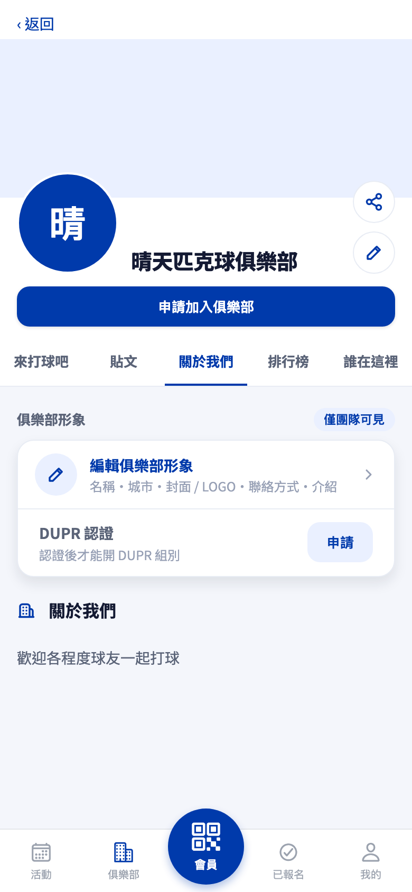
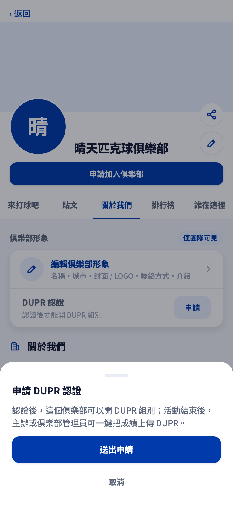
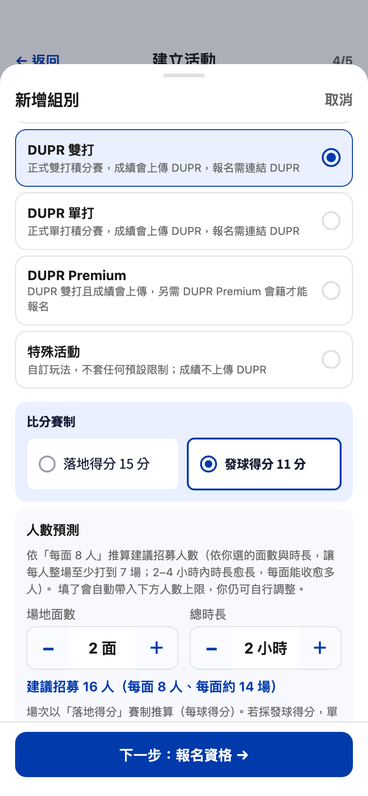
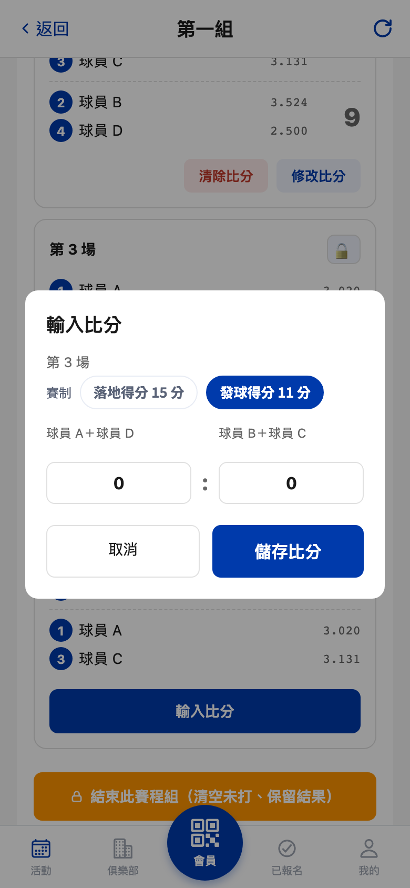
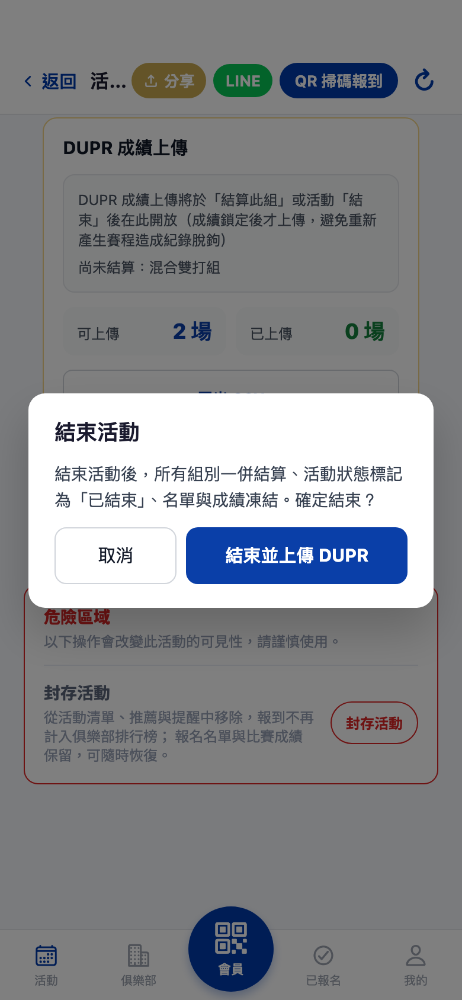

# 第一次上傳 DUPR 成績（團長）

這篇帶你從零開始，完整走一次 DUPR 一鍵上傳。做完之後，你會知道：

- 怎麼替俱樂部申請 DUPR 認證；
- 怎麼建立有 DUPR 組別的活動，並選好比分賽制；
- 輸入比分時，App 為什麼會問你問題、該怎麼回答；
- 結束活動後，怎麼在上傳區把成績送出。

整個流程大約分成五步。第 1 步只需要做一次，之後每場活動從第 2 步開始。

> 開始之前：你需要是這個俱樂部的**團長（俱樂部管理員）**。如果你是場主或主辦，請先請團長完成第 1 步。

---

## 第 1 步：申請俱樂部的 DUPR 認證

俱樂部通過 DUPR 認證之後，才能開「成績會上傳 DUPR」的組別。

1. 進入你的俱樂部頁，切到「**關於我們**」。
2. 在管理卡裡找到「**DUPR 認證**」這一列，旁邊寫著「認證後才能開 DUPR 組別」。按右邊的「**申請**」。

   <!-- 截圖：關於我們頁的管理卡，DUPR 認證列與「申請」按鈕 -->
   

3. 底部會跳出「**申請 DUPR 認證**」視窗。不用連結你自己的 DUPR，也不用填任何人。按「**送出申請**」。

   <!-- 截圖：申請 DUPR 認證底部視窗 -->
   

4. 送出後，「DUPR 認證」這一列會顯示「**已申請，等待 APT 開通**」。

接下來由 APT 審核。審核完成時你會收到通知：

- 開通：通知標題是「**DUPR 認證已開通**」，「DUPR 認證」那一列會變成「**已認證 ✓**」。
- 退回：通知標題是「**DUPR 認證申請未通過**」，內容會寫退回理由。請看[認證被退回後重新申請](../how-to/reapply-after-rejection.md)。

> 小提醒：你也可以在建立活動時，從組別設定裡的「申請 DUPR 認證」按鈕送出申請，效果一樣。

---

## 第 2 步：建立含 DUPR 組別的活動

俱樂部開通後，就可以建立 DUPR 組別。

1. 照平常的方式建立活動，進到新增或編輯組別的畫面。
2. 在「**這個組別怎麼進行？**」選「**DUPR 雙打**」、「**DUPR 單打**」或「**DUPR Premium**」。
   - 選項下方的說明會寫「正式雙打（單打）積分賽，成績會上傳 DUPR，報名需連結 DUPR」。報名這個組別的球員需要先連結自己的 DUPR 帳號。
   - DUPR Premium 也是 DUPR 雙打、成績會上傳，另外要求報名者有 DUPR Premium 會籍。
3. 選好之後，下方會多出「**比分賽制**」，有兩個選項：
   - **落地得分 15 分**（新組別一開始會選這個）
   - **發球得分 11 分**

   請選這個組別實際要打的賽制。輸入比分時，App 會用這裡的設定判斷每場有沒有打完。

   <!-- 截圖：組別設定，「這個組別怎麼進行？」選 DUPR 雙打，下方出現「比分賽制」 -->
   

4. 按「**下一步：報名資格 →**」，照平常的流程完成並發布活動。

> 俱樂部的例行活動模板，組別設定裡同一個位置也有「比分賽制」。

---

## 第 3 步：輸入比分

活動當天，照平常的方式排賽程、輸入比分。DUPR 組別的「輸入比分」視窗，比分上方會多一列「**賽制**」，預設是組別設定的賽制；如果這一場實際打的賽制不同，可以在這裡切換。

<!-- 截圖：輸入比分視窗，比分上方的「賽制」列 -->

按「**儲存比分**」時：

- 如果較高的一方已經打到目標分（落地得分 15 分，或發球得分 11 分），比分直接存好。
- 如果還沒打到目標分，App 會問你「**這場只打到 N 分，是哪種情況？**」，你會看到兩個或三個選項：

| 選項 | 什麼時候選 |
|---|---|
| 改成發球得分 11 分（已打完） | 其實這場是打發球得分 11 分，而且已經打完。只有在賽制是落地得分 15 分、且較高的一方有 11 分以上時才會出現。 |
| 沒打完（比分照存，不上傳 DUPR） | 這場因故沒打完。比分會存下來，但預設不會上傳 DUPR。 |
| 分數輸入錯誤，回去改 | 分數打錯了，回到輸入畫面修改。 |

<!-- 截圖：「這場只打到 11 分，是哪種情況？」三個選項 -->

球員自己輸入比分時，也會看到一樣的問題。詳細規則請看[比分賽制與詢問規則](../reference/score-format-and-upload-states.md#比分賽制與詢問規則)。

---

## 第 4 步：結束活動

所有場次打完、比分確認後，回到活動頁，按最下方的「**結束活動（整批結算所有組別）**」。

App 一定會先跳出確認窗，內容是：

> 結束活動後，所有組別一併結算、活動狀態標記為「已結束」、名單與成績凍結。確定結束？

- 如果這場活動有可以上傳的 DUPR 場次，確認按鈕會是「**結束並上傳 DUPR**」。
- 如果沒有，確認按鈕會是「**確認結束**」。

<!-- 截圖：結束活動確認窗，「取消」與「結束並上傳 DUPR」 -->

按「**結束並上傳 DUPR**」之後，App 會直接帶你到活動頁的「**DUPR 成績上傳**」區。活動有好幾個 DUPR 組別時，要看各組的各場紀錄，請到該組別卡片按「賽事結果」，展開後點「查看賽事細節」。

> 活動結束後，賽程與成績會鎖定。之後只有團長（俱樂部管理員）可以修改比分。

---

## 第 5 步：在上傳區上傳成績

「**DUPR 成績上傳**」區會整理整場活動所有 DUPR 組別的場次。

<!-- 截圖：DUPR 成績上傳區，含「需要你確認」、可上傳／已上傳兩格、上傳按鈕與匯出 CSV -->

1. **先處理「N 場需要你確認」**（如果有的話）。這些是比分沒打到目標分、或被標記沒打完的場次。每一場都要決定要不要上傳，做法請看[處理需要你確認的場次](../how-to/handle-needs-confirm.md)。沒確認的場次不會被上傳，按鈕下方會提醒「沒確認的 N 場不會上傳」。
2. 看一下「**可上傳**」和「**已上傳**」兩格的數字。
3. 按「**上傳 N 場到 DUPR**」。
4. 上傳時，區塊會顯示「**上傳中… 已送 X / N 場**」和進度條。請等它跑完。

   <!-- 截圖：上傳中進度條 -->

5. 跑完後，區塊會改成顯示三格數字：「**已上傳**」、「**沒送成功**」、「**待對帳**」。
   - 如果「沒送成功」有數字，會出現「**球員重新連結後，重試 N 場**」按鈕。
   - 如果「待對帳」有數字，會出現「**確認狀態（不會重複送）**」按鈕。

   各數字的意思請看[上傳區各狀態與數字的意義](../reference/score-format-and-upload-states.md#上傳區各狀態與數字的意義)。

如果某個組別有球員沒有連結 DUPR，這個組別會標示「**用 CSV**」，不會被計入可上傳的場數。這種組別請改用[匯出 CSV](../how-to/export-csv.md)。

---

## 完成了

你已經完成第一次 DUPR 一鍵上傳。之後每場活動，只要從第 2 步開始做就可以。

接下來可以看看：

- [誰能做什麼（角色對照表）](../reference/roles-and-notifications.md#誰能做什麼)：主辦、場主和球員各自能做什麼。
- [從通知前往上傳區](../how-to/from-notification-to-upload.md)：不能上傳的人結束活動、而且還有場次待處理時，你會收到提醒。
- [暫時無法上傳到 DUPR 時怎麼辦](../how-to/rep-account-unavailable.md)
